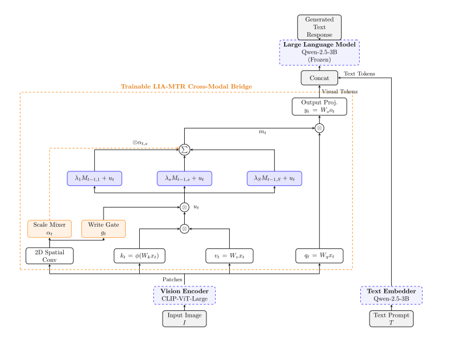
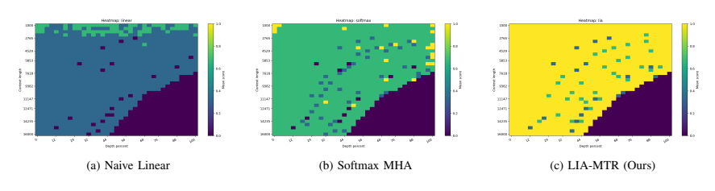
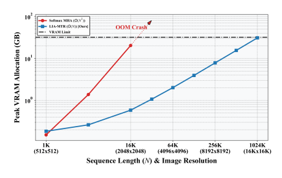

<div align="center">

# LIA-MTR
### Linear Multi-Timescale Retention as a Memory-Efficient Vision-Language Bridge

**Ashfak Yeafi · Mehedi Hasan · Md Khairul Islam**

[Paper PDF](paper/paper.pdf) · [arXiv](https://arxiv.org/abs/2608.01614) · [Results](#reported-results) · [Code availability](#code-availability)

**Linear sequence interaction · Gated recurrent retention · Multi-timescale visual context**

</div>



*Figure 1 from the accompanying preprint: vision features pass through the retention bridge before entering the language model.*

## Overview

LIA-MTR studies how to mix visual sequence context without the quadratic all-pairs interaction of standard softmax attention. It combines an ELU-based positive feature mapping, an adaptive write gate, parallel recurrent memory tracks, and a token-dependent scale mixer.

The bridge sits between **CLIP-ViT-Large-Patch14** and **Qwen-2.5-3B-Instruct**. Its linear-complexity statement concerns sequence interaction for fixed embedding dimension and a fixed number of retention tracks; it is not a claim that the entire vision-language model has constant memory or unlimited practical context.

**Research status:** arXiv preprint, 2026. This repository contains the paper, selected figures, and reported-result documentation. Peer-reviewed acceptance is not claimed.

## Method

- **Positive key features:** ELU-based mapping supports the recurrent accumulation mechanism.
- **Adaptive write gate:** token-dependent gating controls information injected into the retention state.
- **Multiple decay scales:** log-linearly distributed decays from 0.70 to 0.995 provide short and long memory horizons.
- **Scale mixing and readout:** token-specific weights combine retention tracks before the final bridge projection.

The paper analyzes bounded recurrent states under bounded token injections and decay factors strictly between zero and one. These assumptions describe the recurrence; they do not by themselves establish factual reliability or end-to-end generation quality.

## Training and evaluation

| Stage | Data | Trainable components |
| --- | --- | --- |
| Feature alignment | 150K image-caption pairs | Bridge; visual encoder and LLM frozen |
| Instruction tuning | LLaVA-1.5 mix, 665K samples | Bridge and LLM; visual encoder frozen |

The study compares the bridge with a matched MLP baseline, evaluates synthetic Needle-in-a-Haystack retrieval, profiles forward-pass memory, and reports MME measurements. Figure 1 depicts the frozen-backbone alignment configuration; the LLM is trained jointly with the bridge in phase 2 as described in the paper's training protocol.

## Reported results

These are the paper's reported measurements, not independent reruns for this repository. MME values retain the paper's percentage presentation and should not be interchanged with differently aggregated MME leaderboard scores.

| Evaluation | MLP baseline | LIA-MTR |
| --- | ---: | ---: |
| Phase 1: Existence | 81.67% | 91.67% |
| Phase 1: overall | **62.30%** | 58.42% |
| Phase 2: scene recognition | 78.75% | **90.40%** |
| Phase 2: spatial positioning | **43.33%** | 35.00% |
| Phase 2: overall | 68.11% | **71.00%** |

The results show a trade-off: overall instruction-tuned performance and scene recognition improve in the reported setting, while localized spatial positioning decreases. Phase 1 overall performance also favors the MLP baseline.

### Sequence-routing study



*Figure 2: the paper's synthetic retrieval heatmaps. These are synthetic sequence-routing probes, not image segmentation or unrestricted real-world visual reasoning results.*

### Memory study

The abstract and Figure 3 caption report **262,144 visual patches within 11.2 GB VRAM**, with the softmax MHA comparison failing at **16,384 patches** under the stated 32 GB constraint.



*Figure 3, reproduced from the paper. The plot's displayed sequence-length range extends beyond the numerical operating point stated in the abstract/caption. The headline above follows the paper's text; the figure is not used to infer additional measured operating points. This bridge-level forward-pass study does not establish full-VLM training or generation at the same lengths.*

## Scope and future work

The instruction-tuning experiment is limited to single-image interactions. Interleaved multi-image and continuous video evaluation remain future work. Synthetic retrieval, memory scaling, and downstream MME performance are distinct experiments and should be interpreted separately.

## Code availability

**Code will be available upon acceptance of the paper.** The current repository is a paper companion; source code, checkpoints, and execution commands are not yet released here.

## Citation

```bibtex
@misc{yeafi2026liamtr,
  title={Linear Multi-Timescale Retention as a Memory-Efficient Vision-Language Bridge},
  author={Yeafi, Ashfak and Hasan, Mehedi and Islam, Md Khairul},
  year={2026},
  eprint={2608.01614},
  archivePrefix={arXiv},
  primaryClass={cs.CV},
  url={https://arxiv.org/abs/2608.01614}
}
```

See [figure provenance](assets/README.md). Model and dataset use remains subject to the original providers' terms.

[Research profile](https://github.com/mhasan96) · [Website](https://sites.google.com/view/i-am-mehedi) · [Contact](mailto:hasanme1@msu.edu)
